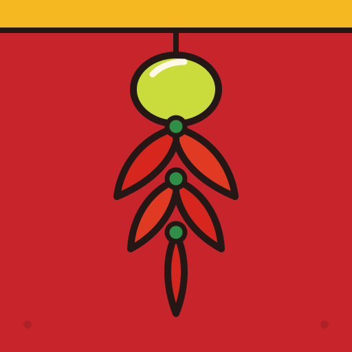
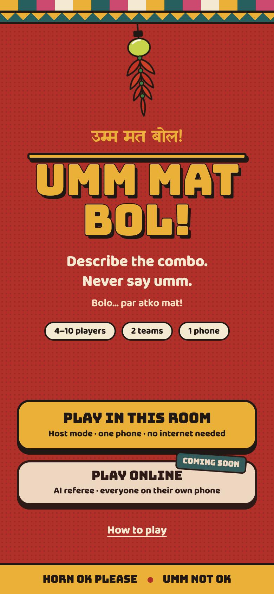
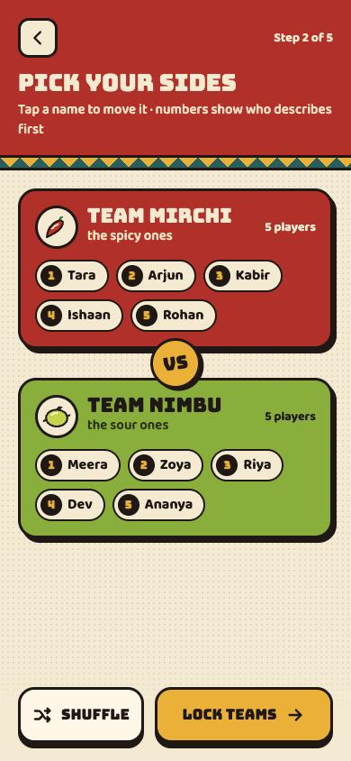
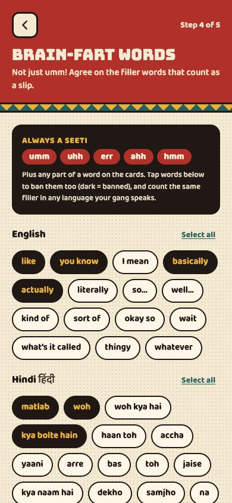
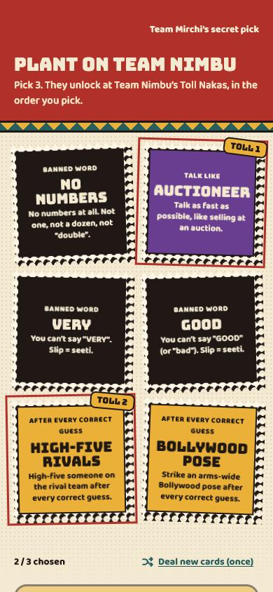
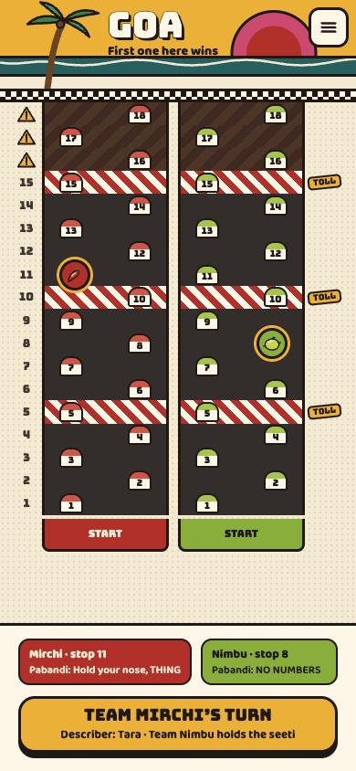
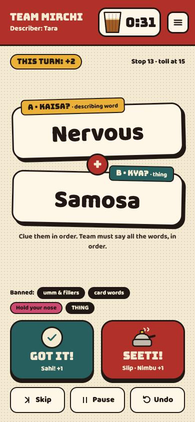
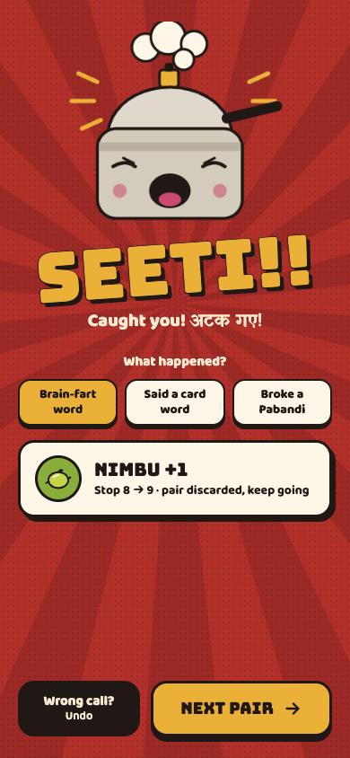
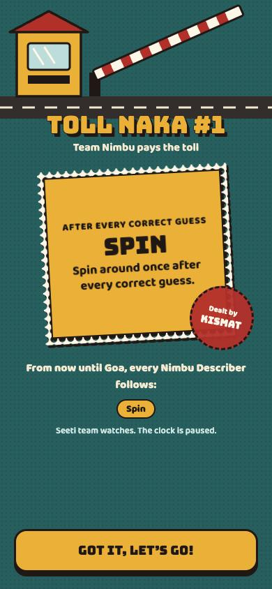
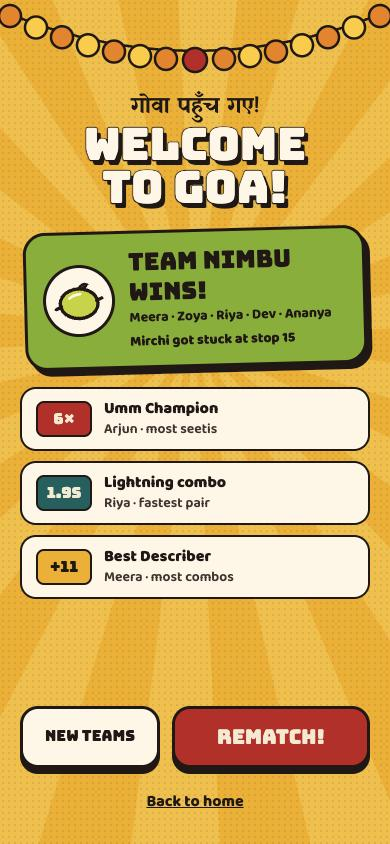

<p align="center">
  
</p>

<h1 align="center">Umm Mat Bol!</h1>

<p align="center">
  <b>The desi party game where saying "umm" costs you the road to Goa.</b><br />
  Describe the combo. Never say umm. <i>Bolo… par atko mat!</i>
</p>

<p align="center">
  4–10 players · 2 teams · 1 phone · no internet needed
</p>

<p align="center">
  <a href="https://umm-mat-bol.vercel.app"><b>▶ Play now at umm-mat-bol.vercel.app</b></a>
</p>

---

## Screenshots

| Home | Teams | Brain-fart words |
| :---: | :---: | :---: |
|  |  |  |
| **Secret Pabandi draft** | **Road to Goa** | **Live turn** |
|  |  |  |
| **SEETI!** | **Toll Naka** | **Winner** |
|  |  |  |

## How to play

1. **Split into two teams:** Team Mirchi vs Team Nimbu.
2. **Get two secret words.** The Describer sees a describing word (*Kaisa?*) and a thing (*Kya?*), like **Nervous + Samosa**.
3. **Race the chai timer.** Get your team to say both words, in order, within 45 seconds. Each combo moves you one stop closer to Goa; then grab the next pair.
4. **Never brain-fart.** It's not just umm: uhh, err, hmm and every filler on your group's list (*like, basically, matlab, mhanje…*) is a slip. So is saying any part of a card word.
5. **SEETI!** The other team listens. Catch a slip and they move one stop forward instead.
6. **Pay at the Toll Nakas.** Before the game, each team secretly plants Pabandi cards (house rules) on the other. Reach a Toll Naka and your next Pabandi unlocks for the rest of the game.
7. **Survive the Ghat Section.** On the last three stops, a slip also slides you back one stop.
8. **First to Goa wins.** *Goa pahunch gaye!*

### Masala twists (switch each on or off)

| Twist | What it does |
| --- | --- |
| **Ghat Section** | Last 3 stops: a slip also pushes the Describer's team back one stop |
| **Chori** | Time runs out mid-pair? The other team gets one guess to steal +1 |
| **Jugaad token** | Once a game, switch off one of your Pabandis for a single turn |
| **Dhamaka cards** | About 1 pair in 12 is a three-word combo worth +2 |
| **Galat Seeti** | Host overrules a wrong seeti? The Describer's team gets +1 |

## What's inside

- **340 describing words × 438 things** in three packs (Classic, Desi Tadka, Bollywood): about 149,000 combos, plus a Family-safe switch.
- **107 Pabandi cards** in seven kinds: banned words (*THE, NO NUMBERS, ENGLISH ONLY*), banned letters, talk-like voices (*news anchor, cricket commentator, filmy villain, GPS voice*), body rules (*naagin hands, kaan pakdo*), after-every-guess actions (*"Jai Ho!", truck-horn honk*), clue rules (*end every sentence with "ji"*) and guesser rules (*sing your guesses*). The draft deals balanced hands so no team gets an unplayable stack.
- **Brain-fart starter lists in English, Hindi and Marathi**, plus your own words for any language.
- **Sounds synthesized live** with the Web Audio API: pressure-cooker whistle, temple-bell ding, truck horn, ticking clock, toll drum roll, dhol fanfare. No audio files.
- **Offline PWA:** add it to your home screen and play anywhere. The game saves itself; a reload mid-turn comes back paused.
- **Awards** at the end: Umm Champion, Lightning combo, Best Describer.

## Run it

```bash
npm install
npm run dev        # http://localhost:5173
npm test           # rules engine tests
npm run build      # production build + offline PWA in dist/
```

## Stack

React 19 · TypeScript · Vite 8 · Tailwind CSS 4 · Zustand · Motion · vite-plugin-pwa · Vitest. Deployed on Vercel.

## Where things live

| Path | What |
| --- | --- |
| `src/data/words.ts` | Word decks (Kaisa? describing words, Kya? things) in three packs |
| `src/data/pabandi.ts` | All Pabandi cards and their kinds |
| `src/data/fillers.ts` | Brain-fart starter lists in English, Hindi and Marathi |
| `src/game/engine.ts` | Pure rules engine: turns, slips, tolls, Ghat, Chori, Jugaad, Dhamaka, undo, winner |
| `src/game/engine.test.ts` | Tests for every rule and twist |
| `src/game/store.ts` | Zustand store: connects the engine to the UI and sounds, saves the game |
| `src/audio/sfx.ts` | Synthesized sound effects |
| `src/screens/` | Setup screens (`Setup.tsx`), gameplay screens (`Play.tsx`), pause menu (`Menu.tsx`) |
| `src/ui/` | Buttons, stamps, toggles (`kit.tsx`), illustrations (`art.tsx`), icons |

## Add your own cards

- **Words:** add to the arrays in `src/data/words.ts`. Duplicates are removed automatically.
- **Pabandi cards:** add an entry to `PABANDI` in `src/data/pabandi.ts` with a unique `id`, a `kind`, a short `title` for the stamp and a one-sentence `rule`.
- **Filler words:** add to a language in `src/data/fillers.ts`.

## Roadmap

- **Online mode:** everyone plays on their own phone, with an AI referee that listens for brain-farts and card words, judges guesses and keeps score.

## Credits

Game mechanics are inspired by the party game *You Can't Say Umm*. Umm Mat Bol! is an independent fan project with its own name, theme, artwork and word lists; it is not affiliated with or endorsed by the original game's publisher.

## License

[MIT](LICENSE)
